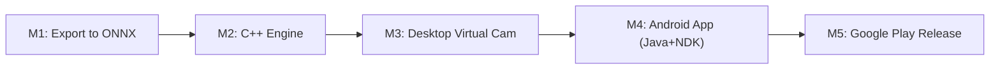

# EdgeDepth-Lite: Real-Time Monocular Depth & Synthetic Aperture Platform

This repository contains the interactive prototype, architecture specifications, and commercial development roadmap for **EdgeDepth-Lite** — real-time monocular depth estimation, physical aperture simulation, and depth-vision filters.

---

## 1. Project Overview & Architecture

Modern mobile and webcam hardware are constrained by small sensors and fixed physical apertures, making it optically impossible to achieve shallow depth of field (bokeh) naturally. This project demonstrates an end-to-end pipeline that takes a 2D image, predicts a continuous depth map using **Depth Anything V2**, linearizes the depth metric to eliminate non-linear sensitivity distortion, and renders optical circle-of-confusion (CoC) defocus blur guided by user-selected focal planes and response curves.

```
+------------------+       +-------------------------+       +------------------------------+
| Input Image      | ----> | Depth Estimation        | ----> | Linear Metric Depth          |
| (RGB Frame)      |       | (Depth Anything / Conv) |       | z = 1/m normalized in [0, 1] |
+------------------+       +-------------------------+       +------------------------------+
                                                                            │
                                                                            ▼
                                                             +------------------------------+
                                                             | Synthetic Bokeh Engine       |
                                                             | - Focus Depth Plane (0.0-1.0)|
                                                             | - Razor-thin DOF (>= 0.000)  |
                                                             | - 6 Blur Response Curves     |
                                                             | - 7-Tier Pyramid Blend       |
                                                             +------------------------------+
                                                                            │
                                                                            ▼
                                                             +------------------------------+
                                                             | Rendered Bokeh Output        |
                                                             +------------------------------+
```

---

## 2. Commercial Product Ideas (Based on [`.md`](.md))

### Product A: "DSLR-Cam" Virtual Webcam for Online Meetings (Zoom / Meet / Teams / OBS)
* **The Problem:** Standard meeting platform blur (Zoom/Teams) uses coarse binary segmenters that produce artificial halos, choppy borders, and cut off hair/ears.
* **The Solution:** A lightweight background application that captures your webcam, generates a continuous depth map, applies progressive optical bokeh (blurred background, sharp shoulders, subtle falloff), and outputs to a **Virtual Camera Driver** (`v4l2loopback` on Linux, DirectShow on Windows).
* **Key Features:**
  * Virtual lens aperture slider (f/1.4, f/2.8, f/4).
  * 3D Studio lighting and relighting derived from surface normal vectors.

### Product B: "Cinematic Depth Cam" for Android (Google Play Store)
* **The Problem:** Budget and mid-range Android devices have fixed lenses and lack hardware telephoto lenses for natural portrait video.
* **The Solution:** A camera app recording photos and video with an embedded depth channel:
  * **Post-Capture Refocus (Tap-to-Focus):** Click any person or object in the photo *after* taking it to shift the focal plane.
  * **3D Parallax Photos ("Wigglegrams"):** Export moving 3D photos for social media by panning a virtual camera using the depth map.
  * **Cinematic Video:** Real-time shallow depth-of-field video recording.

---

## 3. Technology Stack & Production Architecture (C++ / Java / NDK)

```
+---------------------------------------------------------------------------------+
|                                CORE C++ ENGINE                                  |
|   (Shared between Desktop and Mobile for maximum reuse and 60+ FPS speed)       |
|                                                                                 |
|   1. ONNX Runtime C++ API (INT8 / FP16 hardware acceleration)                   |
|   2. OpenCV C++ (Image transformations, frame buffers)                         |
|   3. OpenGL ES 3.0 / Vulkan Shaders (Real-time GPU Bokeh blur pass)             |
+---------------------------------------------------------------------------------+
             │                                                    │
             ▼ (Desktop)                                          ▼ (Mobile via JNI)
+---------------------------------------+   +-------------------------------------+
|         DESKTOP APPLICATION           |   |           ANDROID APP (APK)         |
|                                       |   |                                     |
| • Language: Modern C++ (C++17/20)     |   | • Language: Java / Kotlin           |
| • GUI: Qt6 / QML or ImGui             |   | • Framework: Android SDK + CameraX  |
| • Virtual Cam:                        |   | • Bridge: JNI (Java Native Interface|
|   - Linux: v4l2loopback               |   |   calls the shared C++ engine)      |
|   - Windows: OBS VirtualCam / UnityCam|   | • Store: Google Play Store          |
+---------------------------------------+   +-------------------------------------+
```

### Why This Stack?
1. **Zero Logic Duplication:** The heavy neural network inference and optical blur shaders are written once in **C++**.
2. **On Android:** Use **Java/Kotlin** for the user interface and CameraX hardware controls, and hook into your C++ engine via **JNI (NDK)**.
3. **On Desktop:** Compile the exact same C++ engine directly into a native `.exe` or Linux binary.

---

## 4. Real-Time Edge Models (<15 ms)

| Model Architecture | Parameter Count | Latency (Mobile / Edge) | Best Use Case |
| :--- | :---: | :---: | :--- |
| **EdgeDepth-Lite ([`.md`](.md))** | ~4.2M (ConvNet) | **~8–15 ms** | Distilled MobileNetV3-Small + ASPP bottleneck. |
| **Depth Anything V2 (Small) INT8** | ~24.8M | **~35–50 ms (GPU/NPU)** | High fidelity desktop virtual camera with GPU. |
| **FastDepth (MobileNet-NNConv)** | ~1.3M | **~6–10 ms** | Ultra-lightweight real-time depth for budget mobile phones. |
| **MediaPipe Tasks (Selfie Depth / Seg)**| ~1.5M | **<5 ms** | Google's mobile library with native Java/C++ support. |

---

## 5. Linearizing Depth: Eliminating Sensitivity Distortion

Depth models output disparity $m \approx k/z$. In raw disparity, near distances change $55\times$ faster than far distances. Taking the square root still leaves a $19.5\times$ distortion.

To make depth sensitivity **completely uniform ($1.0\times$ constant ratio)**:
$$\frac{1}{z} = \frac{1}{z_{\text{far}}} + m \cdot \left(\frac{1}{z_{\text{near}}} - \frac{1}{z_{\text{far}}}\right)$$
$$z = \frac{1}{\frac{1}{z_{\text{far}}} + m \cdot \left(\frac{1}{z_{\text{near}}} - \frac{1}{z_{\text{far}}}\right)}$$

### Sky Singularity & Outlier Clamping
When disparity $m \to 0$ (sky / optical infinity), $1/m \to \infty$. To prevent the sky from blowing out the normalization:
1. **Sky Hyperfocal Floor:** Disparity is clamped to an optical floor (`sky_floor = 0.04`).
2. **Robust Percentile Normalization:** $z$ is scaled using 0.5%–99.5% percentiles.
3. **Standard Direction:** Near objects = `1.0` (brightest), Sky/Horizon = `0.0` (pure dark).

---

## 6. Step-by-Step Learning & Development Plan



1. **Milestone 1 (Export to ONNX):** Convert the PyTorch model to `.onnx` and quantize it (`FP16`/`INT8`).
2. **Milestone 2 (Build the C++ Engine):** Write a standalone C++ program using `libonnxruntime-dev` and OpenCV C++ to run real-time camera inference.
3. **Milestone 3 (Desktop Virtual Camera):** Stream C++ output frames to `v4l2loopback` (Linux) or OBS VirtualCam (Windows) for Zoom/Meet.
4. **Milestone 4 (Android App):** Build an Android Studio project with **CameraX** (Java/Kotlin), hooking into the C++ engine via **JNI (NDK)**.
5. **Milestone 5 (Google Play Store Release):** Compile a signed Android App Bundle (`.aab`) and publish on the Google Play Console.

---

## 7. Current Repository Structure

```
edge-depth-estimation/
├── .md                         # Original EdgeDepth-Lite convolutional spec
├── README.md                   # Complete architectural guide & product roadmap
├── run.sh                      # One-click launcher (auto-manages venv & dependencies)
├── requirements.txt            # Python dependencies (PyTorch, Transformers, OpenCV, Gradio)
├── assets/
│   └── sample_desk.jpg         # Synthetic multi-depth test image
├── scripts/
│   └── create_sample_assets.py # Procedural generation script for multi-depth test scenes
├── src/
│   ├── app.py                  # Interactive Gradio web application with UI sliders
│   ├── bokeh_blur.py           # Optical depth-of-field rendering engine (6 curves & multi-tier blur)
│   ├── depth_estimator.py      # Depth Anything V2 model wrapper with 1/m linear depth inversion
│   └── run_pipeline.py         # Headless CLI runner for batch image processing
└── tests/
    └── test_bokeh.py           # Unit test suite verifying monotonic blur, curves & DOF isolation
```

---

## 8. Quickstart & Prototype Verification

### One-Click Launch (No manual venv activation needed)
```bash
./run.sh
```

### Manual Usage
```bash
# 1. Activate environment
source .venv/bin/activate

# 2. Run unit tests
python -m unittest discover tests

# 3. Launch interactive app
python src/app.py

# 4. Run headless CLI test
python src/run_pipeline.py --image assets/sample_desk.jpg --focus-depth 0.65 --blur-power 0.8
```
