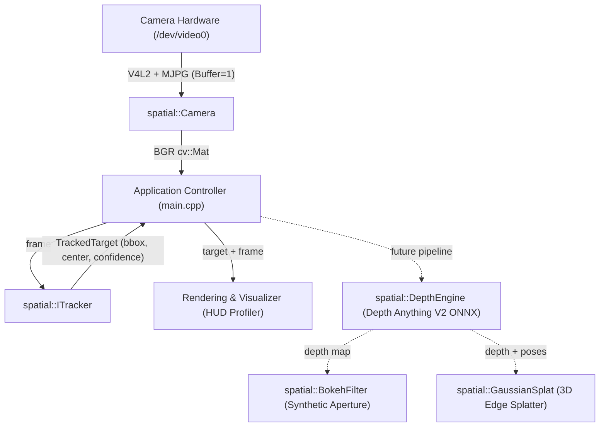

# Edge Vision & Depth Engine: Architectural Blueprint & Roadmap

This document serves as the master guide, educational walkthrough, and task tracking board for the C++ Edge Vision Engine.

---

## 1. Project Philosophy & Core Architecture

The system is engineered as an **Edge-First Computer Vision & Spatial Engine**, designed to bridge real-time 2D camera feeds with upcoming 3D spatial computing (Depth Estimation, Synthetic Bokeh, and 3D Gaussian Splatting).



### Key Architectural Patterns
1. **Separation of Mechanism & Policy**:
   - **Mechanism** ([`Camera`](file:///home/mrctrl/Desktop/Workspace/projects/edge-depth-estimation/cpp/src/camera.cpp), [`Tracker`](file:///home/mrctrl/Desktop/Workspace/projects/edge-depth-estimation/cpp/src/tracker.cpp)): Owns hardware communication, math, and model inference. Reports success/failure via booleans or data structures without hardcoding UI popups or application-level exits.
   - **Policy** ([`main.cpp`](file:///home/mrctrl/Desktop/Workspace/projects/edge-depth-estimation/cpp/apps/main.cpp)): Orchestrates the execution loop, measures latencies, and decides fallbacks.
2. **Polymorphic Strategy Pattern (`ITracker`)**:
   - The engine defines an abstract contract ([`ITracker`](file:///home/mrctrl/Desktop/Workspace/projects/edge-depth-estimation/cpp/include/spatial/tracker.hpp#L23-L32)). Concrete algorithms (`DnnFaceTracker`, `HaarFaceTracker`, `CenterTracker`) encapsulate their own internal buffers and dependencies. Adding a new tracker never requires modifying existing tracker code.

---

## 2. Directory Structure & File Roles

```text
edge-depth-estimation/
├── CMakeLists.txt              # Root CMake configuration (delegates to cpp/)
├── cpp/
│   ├── CMakeLists.txt          # Library target (spatial_core) + Binary target (main)
│   ├── include/spatial/
│   │   ├── camera.hpp          # Hardware camera capture abstraction
│   │   ├── tracker.hpp         # ITracker interface & target structs
│   │   ├── depth_engine.hpp    # [Planned] Monocular depth inference engine
│   │   ├── bokeh_filter.hpp    # [Planned] Physics-based synthetic depth-of-field
│   │   └── gaussian_splat.hpp  # [Planned] 3D Gaussian representation & export
│   ├── src/
│   │   ├── camera.cpp          # Linux V4L2 backend, MJPG decode, queue management
│   │   └── tracker.cpp         # SSD-ResNet10 DNN, Haar, and CenterPoint logic
│   ├── apps/
│   │   └── main.cpp            # Real-time event loop & latency profiler HUD
│   └── data/
│       ├── deploy.prototxt     # SSD-ResNet10 network graph definition
│       └── res10_300x300...    # SSD-ResNet10 trained weights (11MB)
└── prototype/                  # Python Gradio reference implementation (on prototype branch)
```

---

## 3. Real-Time Performance & Camera Diagnosis

### Why Camera Latency Matters (`Cam: ~45ms`)
* In video streaming, framerate is limited by the slowest component in the loop:
  $$\text{Frame Time} = \Delta t_{\text{cam}} + \Delta t_{\text{ai}} + \Delta t_{\text{gui}}$$
* When `Cam` is 45ms, the physical hardware is delivering:
  $$\frac{1000\text{ ms}}{45\text{ ms}} \approx 22\text{ FPS}$$

### Why Manual Exposure Lowered Image Quality
* Lowering exposure time cuts sensor integration time (shutter opens and closes faster).
* In indoor lighting, shorter exposure lets in fewer photons. The camera compensates by cranking up analog sensor gain (ISO), introducing visible sensor noise (grain).
* **The Engineering Compromise**:
  - For high framerates (30–60 FPS) in low light: Improve physical ambient lighting (a desk lamp or window).
  - For high image quality: Allow exposure to float slightly, or use multi-threading (decoupling camera capture from processing).

### Advanced Performance Optimization: Thread Decoupling
To achieve a locked 60 FPS regardless of camera sensor hiccups:
- **Thread 1 (Capture Worker)**: Continuously pulls frames from the camera into a thread-safe circular buffer with mutex/atomic flags.
- **Thread 2 (Processing Worker)**: Grabs the latest available frame, runs AI tracking and depth estimation, and renders without waiting synchronously on the camera shutter.

---

## 4. Development Progress & Target Checklist

Use this checklist to track your learning and progress as you take ownership:

### Phase 1: Camera & Tracking Mastery (Current)
- [x] Basic OpenCV camera loop at 720p.
- [x] Implement polymorphic tracking interface (`ITracker`).
- [x] Integrate deep learning face detection (`DnnFaceTracker` with SSD-ResNet10).
- [x] Add real-time millisecond latency profiler (`Cam`, `AI`, `GUI`).
- [x] Clean up unused/broken model files.
- [ ] **Exercise**: Experiment with camera exposure & gain via [`Camera::setExposure`](file:///home/mrctrl/Desktop/Workspace/projects/edge-depth-estimation/cpp/src/camera.cpp#L85-L106) to find the best balance of grain vs. latency.
- [ ] **Exercise**: Implement a separate capture thread (`std::thread` + `std::atomic<bool>`) inside `Camera` to completely eliminate camera block from the main loop.

### Phase 2: Monocular Depth Engine (Next)
- [ ] Export `Depth-Anything-V2-Small` to ONNX (using the Python prototype weights).
- [ ] Implement [`spatial::DepthEngine`](file:///home/mrctrl/Desktop/Workspace/projects/edge-depth-estimation/cpp/include/spatial/depth_engine.hpp) using `cv::dnn::readNetFromONNX`.
- [ ] Pre-process image ($518 \times 518$ normalized float tensor with ImageNet mean/std).
- [ ] Extract inverse depth map $m \in [0, 1]$ and linearize to metric depth $z \propto 1/m$.

### Phase 3: Synthetic Bokeh Filter
- [ ] Implement [`spatial::BokehFilter`](file:///home/mrctrl/Desktop/Workspace/projects/edge-depth-estimation/cpp/include/spatial/bokeh_filter.hpp).
- [ ] Sample focus depth $z_{\text{focus}}$ from the `TrackedTarget.center` point provided by the tracker.
- [ ] Compute circle of confusion (CoC) map: $C(x, y) \propto |z(x, y) - z_{\text{focus}}|$.
- [ ] Apply depth-guided blur (separable recursive Gaussian or bilateral filter).

### Phase 4: 3D Edge Gaussian Splatting
- [ ] Implement [`spatial::GaussianSplat`](file:///home/mrctrl/Desktop/Workspace/projects/edge-depth-estimation/cpp/include/spatial/gaussian_splat.hpp).
- [ ] Back-project 2D pixels $(u, v)$ and depth $z$ into 3D camera space point clouds:
  $$X = \frac{(u - c_x) \cdot z}{f_x}, \quad Y = \frac{(v - c_y) \cdot z}{f_y}, \quad Z = z$$
- [ ] Export point cloud and splat attributes (position, scale, rotation quaternion, spherical harmonics color) to `.ply` file.

---

## 5. Guide for Future AI & Model Integration

When you integrate a new neural network (such as Depth Anything V2, BlazeFace, or YOLO) into this C++ engine in the future, follow these rules:

### Rule 1: Verify ONNX Compatibility with System OpenCV
- OpenCV's DNN parser in older versions (e.g. OpenCV 4.6.0) does not support newest ONNX Opset versions (Opset 18+).
- **Rule of Thumb**: When exporting models from PyTorch, always specify:
  ```python
  torch.onnx.export(model, dummy_input, "model.onnx", opset_version=12)
  ```
  Opset 11 or 12 is universally supported across virtually all OpenCV 4.x versions.

### Rule 2: Keep Input Dimensions Constant on Edge Devices
- Avoid dynamic input sizes (e.g., resizing the network every frame to match camera changes).
- Fix network input to standard dimensions ($300 \times 300$, $518 \times 518$, or $256 \times 256$).
- Use `cv::resize` on the camera image, run inference on the fixed buffer, and scale the coordinates back to full resolution.

### Rule 3: Memory Re-use in Hot Loops
- Never instantiate `cv::Mat` buffers inside the per-frame `update()` method.
- Declare intermediate buffers (`m_inputBlob`, `m_resizedFrame`) as class private members so memory allocations happen only once during startup.
